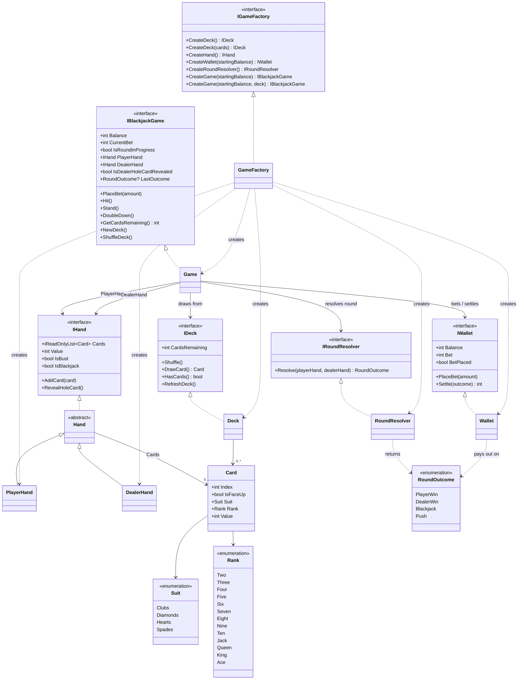
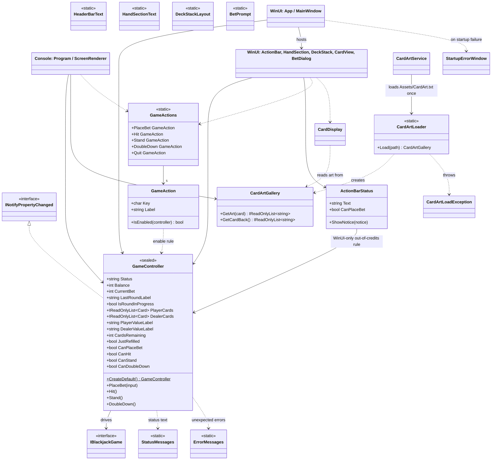

# Blackjack

A single-player-vs-dealer Blackjack game in C#, built with a GUI-independent game
engine so the rules can be tested in isolation. It has two front ends that show
the same screen and are driven by the same engine: a console app and a WinUI 3
desktop app (Windows).

- **Author:** Mikkel Jørgensen
- **Language:** C#
- **Target framework:** .NET 10.0

## Requirements

### Functional requirements

- Console based GUI. A second front end, a WinUI 3 desktop GUI, shows the same
  information and layout, is driven by the same engine and reuses the ASCII card art.
- The game shall support one player against one dealer.
- The game shall use a standard 52-card deck.
- The deck shall be shuffled before a new game starts.
- The player and dealer shall each receive two cards at the start of a round.
- One dealer card shall remain hidden until the player ends their turn.
- The player shall be able to choose Hit or Stand.
- The player shall be able to Double Down when holding exactly two cards.
- The player shall lose immediately if their hand exceeds 21.
- The dealer shall draw cards until reaching at least 17.
- An Ace shall count as either 1 or 11, whichever gives the best valid hand value.
- Jack, Queen and King shall each count as 10.
- A two-card hand worth 21 shall count as Blackjack.
- Blackjack shall beat a normal hand worth 21.
- If player and dealer have equal winning hand values, the round shall end as a push.
- The game shall determine one of these outcomes: Player Win, Dealer Win, Blackjack, Push.
- The player shall start with a fictional balance of 1,000 credits.
- The player shall place a bet before each round.
- A normal win shall pay 1:1.
- Blackjack shall pay 3:2.
- A push shall return the original bet.
- The player shall not be allowed to bet more than their current balance.
- The game shall support starting another round without restarting the application.

### Non-functional requirements

- GUI-independent game logic.
- ASCII art cards for the console-based GUI, also reused by the WinUI front end.

## Project structure

```
src/
  Blackjack.Game/          Game engine (rules, dealing, betting, outcomes) - the GUI-independent core
  Blackjack.Presentation/  Front-end-independent presentation logic shared by both GUIs:
                           GameController, status/error text, action table, card art loading, layout text
  Blackjack.Console/       Console front end (input + drawing only)
  Blackjack.WinUI/         WinUI 3 front end (unpackaged, self-contained, Windows only; input + drawing only)
tests/
  Blackjack.Game.Tests/          xUnit tests for the engine
  Blackjack.Presentation.Tests/  xUnit tests for the presentation logic (GameController, text, layout)
docs/
  process.md               Delivery and review process
  winui-manual-test.md     Manual test checklist for the WinUI front end
.github/                   CI workflow, coverage gate script, review guidelines, PR template
```

Dependencies point one way: `Blackjack.Console` and `Blackjack.WinUI` reference
`Blackjack.Presentation`, which references `Blackjack.Game`. The engine knows nothing
about any UI, and the front ends contain no game rules or status text.

`Blackjack.Game` exposes everything through `IGameFactory`, which is the only
place concrete implementations (`Game`, `Deck`, `Wallet`, ...) are constructed.
Consumers, including both front ends and the tests, program against the
interfaces (`IBlackjackGame`, `IHand`, `IDeck`, ...).

`Blackjack.Presentation` turns the engine into something a screen can bind to.
`GameController` wraps an `IBlackjackGame` and exposes the display state (balance,
bet, last round, both hands and their value labels, deck count, status line), which
actions are currently allowed, and the actions themselves. It implements
`INotifyPropertyChanged`, owns all status wording and the deck-refill rule (a fresh
deck when fewer than 15 cards remain and no round is running), and never throws from
an action. Its API is UI-thread-only: call the actions from UI handlers.

## Class diagram

### Game engine (`Blackjack.Game`)



### Presentation and front ends



## Building and testing

Run from the repository root (the solution is `Blackjack.slnx`):

```
dotnet build Blackjack.slnx -c Release
dotnet test Blackjack.slnx
```

`dotnet build` builds all six projects, including the WinUI app, so it must be run on
Windows.

## Running the front ends

### Console

```
dotnet run --project src/Blackjack.Console -c Release
```

Run it from a real terminal window (at least 96 columns wide). It redraws the screen
after every key and does not work with redirected input or output.

| Key | Action |
|-----|--------|
| B | Place bet (asks for a whole number) |
| H | Hit |
| S | Stand |
| D | Double Down |
| Q | Quit |

### WinUI 3

Prerequisites: Windows 10 1809 (build 17763) or later and the .NET 10 SDK. The
**Windows App SDK** is a NuGet package (`Microsoft.WindowsAppSDK`) that the build
restores automatically, and the app is unpackaged and self-contained, so no MSIX
packaging, Visual Studio workload or separate runtime install is needed.

```
dotnet run --project src/Blackjack.WinUI -r win-x64
```

A launch profile named `Blackjack.WinUI` is defined in
`src/Blackjack.WinUI/Properties/launchSettings.json`, so
`dotnet run --project src/Blackjack.WinUI --launch-profile Blackjack.WinUI` also works.

Or build once and start the exe. The output folder depends on how you built:

| Build | Exe location (under `src\Blackjack.WinUI\`) |
|-------|-----------------------------------------------|
| `dotnet build Blackjack.slnx -c Release` | `bin\Release\net10.0-windows10.0.19041.0\win-x64\Blackjack.WinUI.exe` |
| `dotnet build src/Blackjack.WinUI -c Release -p:Platform=x64` | `bin\x64\Release\net10.0-windows10.0.19041.0\win-x64\Blackjack.WinUI.exe` |
| `dotnet run --project src/Blackjack.WinUI -r win-x64` (Debug) | `bin\x64\Debug\net10.0-windows10.0.19041.0\win-x64\Blackjack.WinUI.exe` |

Same keys as the console (B, H, S, D, Q, in either case) plus mouse clicks on the
action bar. Place Bet opens a dialog. The card art is read from `Assets\CardArt.txt`
next to the exe; if it is missing or incomplete the app shows a "Blackjack cannot
start" window instead of the game. ARM64 builds are not supported on an x64
development machine (XAML compiler errors); use x64.

To check the UI by hand use the checklist in
[docs/winui-manual-test.md](docs/winui-manual-test.md).

### WinUI-only additions

These are deliberate differences from the console app. The console keeps its original
behaviour.

- **Out of credits:** when the balance reaches 0 and no round is in progress, the
  status line reads "You are out of credits." and only Quit stays enabled. The console
  lets you try a bet, which the engine then rejects.
- **Enter / Space after a round:** focus always moves to the first enabled game action
  (Place Bet, Hit, Stand, Double Down), never to Quit, so a stray Enter cannot end the
  game. The exception is the out-of-credits state, where Quit is the only enabled action.
- **Error handling:** an unexpected exception from the engine, or an unhandled UI
  error, is shown in the status line as "Something went wrong: ..." instead of
  crashing the window.

## CI, coverage and review process

Every pull request runs the `CI` workflow (`.github/workflows/ci.yml`): build the
solution in Release, run all tests with coverage, and enforce at least **95% line
coverage** on `Blackjack.Game` and `Blackjack.Presentation`. To reproduce the gate
locally (use any empty folder for `coverage`):

```
dotnet test Blackjack.slnx --configuration Release --collect:"XPlat Code Coverage" --results-directory coverage
powershell -NoProfile -File .github/scripts/check-coverage.ps1 -Threshold 95 -Packages Blackjack.Game,Blackjack.Presentation -Path coverage
```

A PR also needs an independent AI review against
[.github/REVIEW_GUIDELINES.md](.github/REVIEW_GUIDELINES.md) and every acceptance
criterion of its issue met. The branch model, roles and gates are described in
[docs/process.md](docs/process.md).

## Status

- **Engine (`Blackjack.Game`):** dealing, betting, Hit/Stand/Double Down, hand
  scoring (including soft Aces), dealer play to 17, round resolution and payouts,
  and a random `Deck.Shuffle()`, all covered by `Blackjack.Game.Tests`.
- **Presentation (`Blackjack.Presentation`):** `GameController` and the shared
  wording, action table and card-art loading, covered by
  `Blackjack.Presentation.Tests`.
- **Console (`Blackjack.Console`):** fully playable, draws the ASCII card art, and
  runs entirely through `GameController`.
- **WinUI (`Blackjack.WinUI`):** fully playable with the same screen as the console:
  header bar, deck stack, player and dealer hands, action bar with hotkeys, bet
  dialog, reshuffle, quit, and startup-error handling. See the WinUI-only additions
  above.
- Visual and interactive checks (theme, scaling, Narrator, real key repeat) are a
  human task: see [docs/winui-manual-test.md](docs/winui-manual-test.md).

## Known issues

Engine behaviour that is understood but intentionally not changed by the WinUI work
(tracking issue #3):

- **A rejected bet clears the previous round's cards** ([#20](https://github.com/mikk149c/SpecialisterneBlackjack/issues/20)).
  `Game.PlaceBet` replaces both hands before the wallet validates the bet. An invalid
  bet (zero, negative, over the balance) after a finished round therefore makes the
  cards on the table disappear, in both front ends. Balance and last outcome are not
  affected.
- **The dealer draws after the player busts.** `Game.Hit` ends the round on a bust
  through the same path as Stand, so the hole card is revealed and the dealer still
  plays out to 17 before the round resolves. The outcome is the same (dealer wins),
  but extra cards are consumed from the deck. No issue has been filed yet.
- **A failing deck inside `PlaceBet` leaves the round in progress**
  (noted on [#12](https://github.com/mikk149c/SpecialisterneBlackjack/issues/12)). The engine marks the round started before dealing,
  so if drawing throws, the front end shows "Something went wrong" while a round is
  still in progress. Not reachable with a normal 52-card deck.
- `Game.PlayRound()` is an empty placeholder method on the concrete class; the
  front ends do not use it.

Follow-ups from the reviews that are not scheduled (none changes behaviour):

- Console: `Quit`'s enable rule lives in the renderer; a `CanQuit` on `GameController`
  would be cleaner. `Program.cs` still uses `ConsoleKey` literals rather than
  `GameActions.Key`.
- The console keeps `REFILLED` on the deck until the next mapped key (it used to be
  one frame) and no longer shows the old, never-rendered "Goodbye!" status.
- WinUI: the window's minimum size is applied on first load only, so moving to a
  monitor with a different DPI keeps the old pixel minimum.
- WinUI: `CardView` has no High Contrast theme dictionary, and `ActionBarStatus` has
  grown beyond its name (it carries status text and Place Bet availability).
- WinUI: `Debug.WriteLine` is a no-op in Release builds, so an engine fault shows
  "Something went wrong: ..." without a trace; the startup error window ignores
  Escape and exits with code 0.
- `HeaderBarText` column widths are written as sums coupled to the label lengths, and
  `NoLastRound = "-"` is defined in both `HeaderBarText` and `GameController`.
